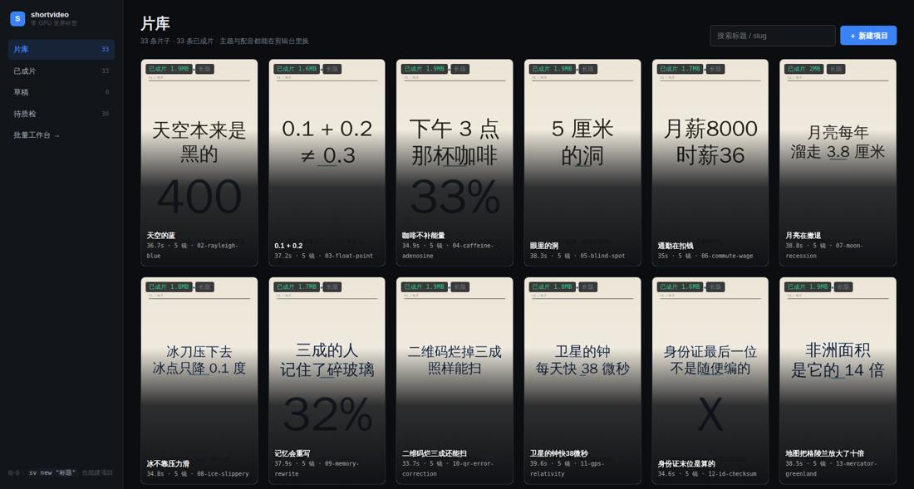
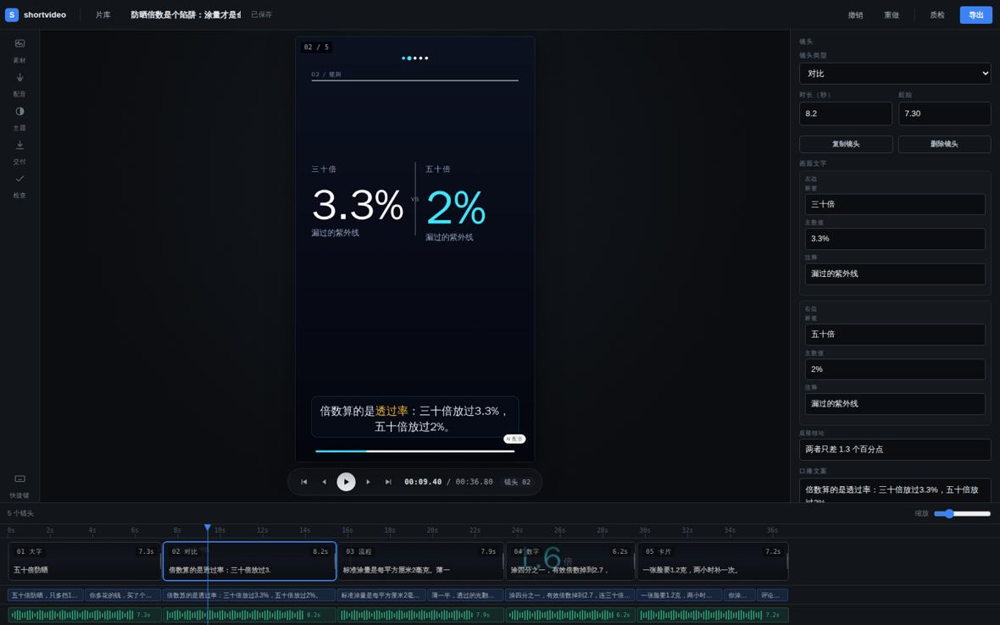
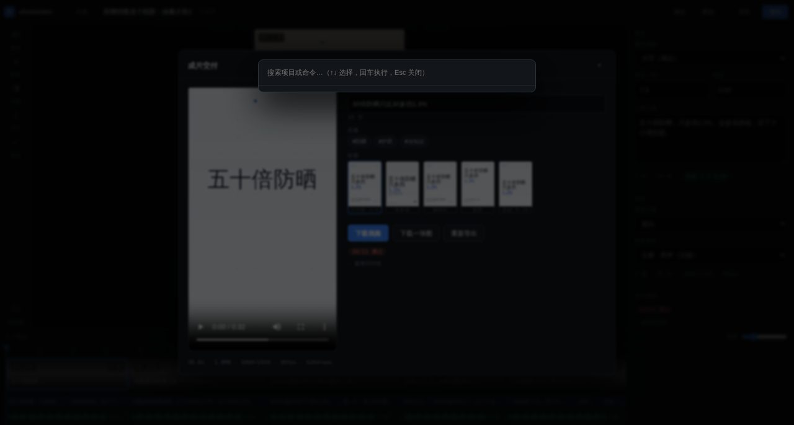

# dsh-shortvideo

**零 GPU 的竖屏科普短视频工作台** —— 从一句话选题到能直接发的成片，
内置剪辑台、五套结构模板、11 道成片门禁 + 界面自检。
画面全部由 Pillow **程序化逐帧渲染**，不调用任何文生图 / 文生视频模型，
所以任何一台普通机器（甚至没有显卡的服务器）都能跑。



<table>
<tr>
<td width="50%"></td>
<td width="50%"></td>
</tr>
<tr>
<td align="center"><sub>剪辑台：三栏 + 三轨时间线 + 帧级预览</sub></td>
<td align="center"><sub>交付面板：成片 + 封面 + 标题 + 话题</sub></td>
</tr>
</table>

## 它是什么

一个给你**干活用**的工作台，不是一堆命令行参数：

| 界面 | 你在这里做什么 |
|---|---|
| **片库** `/` | 看所有片子（封面就是成片里的真实一帧）、按状态筛、搜索、新建 |
| **剪辑台** `/app/` | 拖播放头看画面（帧级）、点镜头改文案/类型/时长、复制与删除镜头、设转场、三轨时间线、⌘K 命令面板、⌘Z 撤销 |
| **交付** | 导出完一屏给全：成片、五张封面、发布标题（带字数预警）、话题 |

改一个字就存（输入停顿 0.7s 自动落盘），写盘前在 `out/<slug>/history/` 留快照，最多 40 份。
撤销/重做覆盖文案、时长、主题、转场，以及**镜头的增删**；一次编辑窗口只算一个撤销点。

右侧「检查」面板分两段：**本地即时体检**（口播与画面数字对不上、语速过快、标题过长、
首镜过长——改一个字就重算）和**流水线质检**（跑过 `verify.sh` 才有结果）。
批量工序（脚本/成片/封面/质检/发布包）留在 `/batch` —— 那是待办清单视图。

## 在 Harness 里打开（可选）

装了 [DeepSeek Harness](https://github.com/deepseek-ai) 的话，工作台可以像「情报雷达」一样
出现在侧边栏，点开就在窗口里用——不用记 IP 和端口：

```bash
dsh plugin --profile web add link:$(pwd)/dsh-plugin
```

它是个同源反代：Harness 把 `/shortvideo/*` 转给本机的编辑器进程，所以走隧道、走反向代理、
换 HTTPS 都跟着 Harness 走。插件源码在 [dsh-plugin/](dsh-plugin/)，按需启动、日志在
`$DSH_HOME/shortvideo/server.log`。

## 快速开始

```bash
git clone https://github.com/sunchendd/dsh-shortvideo.git
cd dsh-shortvideo
./install.sh            # 同步到 ~/.dsh/skills/shortvideo + 建 venv + 装依赖 + 冒烟测试
sv                      # 打开 http://127.0.0.1:8099
```

装完就有 `sv` 命令（软链到 `~/.local/bin/sv`）：

```bash
sv                        # 启动剪辑台
sv list                   # 列出所有项目
sv new "为什么飞机窗户是圆的"
sv export 19-spf-sunscreen
sv qa 19-spf-sunscreen    # 单条质检
sv check                  # 全仓门禁（成片体检 + 界面自检）
```

可选参数：`./install.sh --no-deps`（只更新代码）、`DSH_SKILLS_DIR=/path ./install.sh`、
`SHORTVIDEO_PIP_INDEX=<内网镜像> ./install.sh`。

## 五套结构模板

新建项目不用面对五个空输入框——先选"怎么讲"，再填内容。
每个模板带镜头类型序列、逐句占位提示、可一键填入的示例文案、推荐主题。

| 模板 | 结构 | 适用 |
|---|---|---|
| 五段式讲解 | 钩子 → 规则 → 原理 → 高潮 → 实战 | 大多数硬知识 |
| 对比拆解 | 摆出两个易混的东西，给数字 | 打假 / 辟谣 / 选购 |
| 三点清单 | 三件事各一段 | 收藏向 |
| 单点深挖 | 一个数字往死里挖 | 记忆点极强的短片 |
| 事故复盘 | 事故 → 误判 → 真相 → 代价 → 教训 | 历史与工程 |

模板定义在 `skills/shortvideo/tools/templates.json`，加一个模板不需要改代码。

## 11 道成片门禁 + 界面自检

`verify.sh` 不是单元测试，是**成片体检**——每条片子都要过：

| 门禁 | 查什么 |
|---|---|
| 清单+总分 | 结构完成度打分 |
| 图形事实链 | 画面里的数字和口播是否一致 |
| 文档完整度 | 发布所需材料是否齐全 |
| 发布可行性 | 标题 ≤20 字、≤1024MB、h264+aac、有封面与 AI 标注 |
| 长短版一致 | 长版与 18 秒短版讲的是同一件事 |
| 响度一致 | 全库响度分布（-23 LUFS 一档） |
| 配音情绪 | 音色与语速是否匹配内容情绪 |
| 封面可读性 | 240px 缩略图下标题是否还能读 |
| 前 3 秒留人 | 首镜是否有足够位移/信息量（实测像素差） |
| 画面体检 | 单条片子的构图、语速、留白 |
| 总检 checklist | 以上汇总 + 发布清单 |
| **界面自检** | 不是验片，是验工具本身：`node ui/tools/selftest.js` 在一次性项目上真点一遍（改字→存盘、删镜头→撤销、⌘K、Esc、四个抽屉），11 项断言。抓的是"改了没生效"那一类 bug。 |

门禁阈值来自**实测分布**，不是拍脑袋——例如"前 3 秒留人"的门槛 1.2 秒，
是先量了 33 条片子的静态段长度才定的。

## 六个角色技能

除了流水线，还装了 6 个纯提示词的角色（无依赖）：

- `xhs-creative-director` —— 创意总监：选题打分、钩子设计、五段式结构、爆款标题
- `xhs-art-director` —— 美术指导：色板、排版刻度、视频/封面/一张图三处一致性
- `shortvideo-master` —— 短视频大师：节奏、留白、字幕断句
- `one-image-summary` —— 一张图总结大师：1080×1440 图文笔记
- `ai-art-studio` —— AI 画室：程序化底图/几何插画（五种风格）
- `ui-ux-pro-max` —— 设计情报库：192 套配色 / 74 组字体 / 119 条 UX 准则（离线）

在 dsh 会话里说"用创意总监的角度看一下这个选题"就会触发对应角色。

## 架构

```
brief.json ──draft.py──> content.json ──make.py──> mp4
   选题五句话            镜头/字幕/主题       TTS+逐帧渲染+编码
                              │
                        ┌─────┴─────┬──────────┬─────────┐
                     cover.py   summary2.py  verify.sh  publishcheck.py
                     三流派封面   一张图       11 道门禁   发布可行性
                              │
                        ui/preview.py  ← 剪辑台（帧级预览 + 编辑 + 导出）
```

剪辑台的预览是**用 `min_dur` 拼的近似时间线**，不跑 TTS，单帧 30–90ms；
真实时长以导出为准（配音会把镜头撑长 0.2–0.4 秒）。这个差异写在界面上，不藏。

## 诚实约束

- **没有生成式视觉模型**：画面是程序化排版的图表、色块、大字，不是 AI 画的图。
  这是刻意的选择——它让成本为零、风格统一、无版权风险，但也没有"照片级"的画面。
- **预览 ≠ 成片**：预览不跑 TTS，时长与字幕位置以导出为准。
- **音频轨的波形是占位图形**：真实波形要跑完 TTS 才有，这里不假装。
- **转场只在成片里看得到**：预览是单帧渲染，不合成转场。
- **配音试听不是实时合成**：这台机器连不上 `speech.platform.bing.com`，
  试听是从已用该音色的成片里截一段；从没用过的音色会如实报"试听不可用"，不放静音糊弄。

## 文档

- [剪辑台产品设计](docs/product/editor.md) —— 对标剪映/即梦的拆解与取舍
- [视觉系统](docs/visual-system.md) —— 配色、排版刻度、三处一致性
- [设计品味](docs/design/design-taste.md) —— 反 slop 的具体规则
- [发布计划](docs/publish-plan.md)

## 许可

MIT
